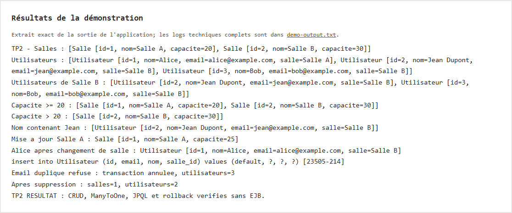
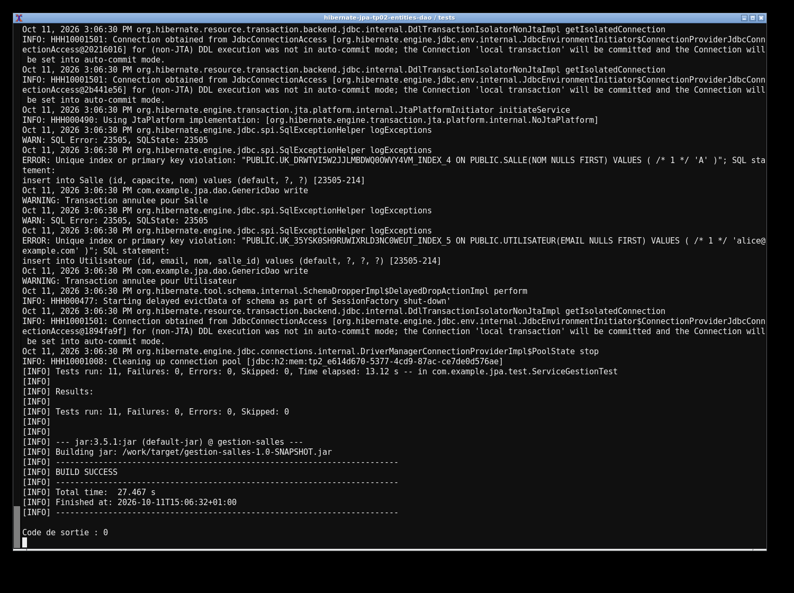

# TP 2 — Entités Salle et Utilisateur, DAO et services JPA

Dans ce TP, j'ai utilisé JPA et Hibernate pour gérer des salles et des utilisateurs. Chaque utilisateur peut être associé à une salle. Le projet permet d'ajouter, rechercher, modifier et supprimer les données avec des DAO et un service de gestion.

J'ai aussi ajouté des recherches par capacité de salle et par nom d'utilisateur. La démo montre les opérations CRUD et le rollback en cas d'email dupliqué. À la fin, il reste une salle et deux utilisateurs.

Pour lancer le projet, il faut Java 17 et Maven. La base H2 fonctionne en mémoire.

```sh
mvn clean test
mvn compile exec:java
```

Les résultats enregistrés donnent **8 tests réussis, sans échec ni erreur**.




